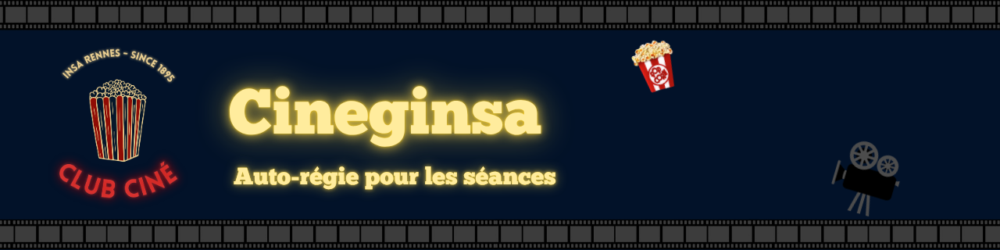

<p align="center">
  
</p>

<p align="center">
  
  
  
  
  
  
</p>

# Cineginsa

Une **auto-régie légère** pour les séances de club ciné. Elle remplace OBS et ses scripts Lua : on saisit les infos de la séance, on pilote au clavier, et l'appli envoie le bon contenu (snacks et prix, infos du film, compte à rebours, puis le film lui-même) sur l'écran du projecteur, pendant que la régie reste sur l'écran du PC.

## Fonctionnement

Deux fenêtres :

| Fenêtre | Écran | Rôle |
|---|---|---|
| **Régie** (Qt Widgets) | PC | Saisie de la séance, boutons de scènes, choix du film |
| **Affichage** (QML) | Projecteur | Scènes animées et lecture de la vidéo |

## Prérequis

- **Qt 6.5 ou +** (modules *Widgets*, *Quick*, *Multimedia*). FFmpeg gère les codecs.

### Linux (apt)

```bash
sudo apt install build-essential cmake qt6-base-dev qt6-declarative-dev \
  qt6-multimedia-dev qml6-module-qtquick qml6-module-qtmultimedia
```

## Compiler et lancer

```bash
git clone https://github.com/clementgvs/Cineginsa.git
cd Cineginsa
cmake -S . -B build
cmake --build build
./build/Cineginsa
```

## Structure

```
Cineginsa/
├── CMakeLists.txt
├── main.cpp
├── mainwindow.cpp / .h / .ui   ← fenêtre de régie
├── display.qml                 ← écran projecteur
├── assets/
│   ├── banner.png
│   └── ... 
├── LICENSE
└── THIRD_PARTY_NOTICES.md
```

## Licence

- **Code** : [MIT](LICENSE).
- **Qt** : utilisé sous licence **LGPL v3**, en liaison dynamique. Voir [THIRD_PARTY_NOTICES.md](THIRD_PARTY_NOTICES.md), à joindre à chaque exécutable distribué avec le texte de la LGPL.
- **Visuels du club** (logo, affiches, images de snacks) : non couverts par la licence MIT, tous droits réservés. Ils ne sont pas inclus dans le dépôt.
