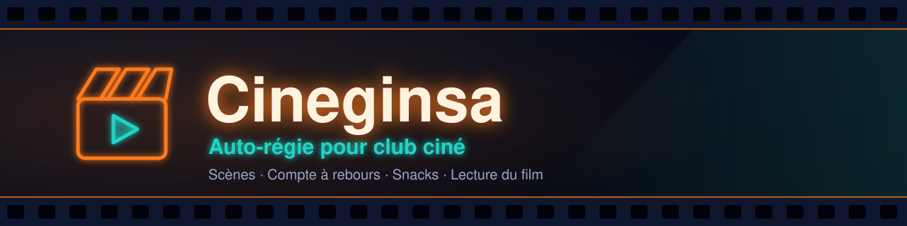

<p align="center">
  
</p>

<p align="center">
  
  
  
  
  
  
</p>

# Cineginsa

Une **auto-régie légère** pour les séances de club ciné. Elle remplace OBS et ses scripts Lua : on saisit les infos de la séance, on pilote au clavier, et l'appli envoie le bon contenu (snacks et prix, infos du film, compte à rebours, puis le film lui-même) sur l'écran du projecteur, pendant que la régie reste sur l'écran du PC.

## Pourquoi

- OBS est lourd et les scripts Lua sont fragiles.
- Un club ciné n'a besoin que de quelques scènes et d'un lecteur vidéo fiable.
- Tout doit marcher **hors ligne**, sur un seul PC, sans rien installer à côté.

## Fonctionnement

Deux fenêtres, un seul programme :

| Fenêtre | Écran | Rôle |
|---|---|---|
| **Régie** (Qt Widgets) | PC | Saisie de la séance, boutons de scènes, choix du film |
| **Affichage** (QML) | Projecteur | Scènes animées et lecture de la vidéo |

Le cœur est écrit en C++ : le lecteur (`QMediaPlayer`) et l'état de la séance y vivent, et le QML ne fait qu'afficher.

## Fonctionnalités

État actuel du prototype :

- [x] Fenêtre de régie en Qt Widgets
- [x] Fenêtre d'affichage QML placée sur le 2e écran (ou en fenêtre s'il n'y en a qu'un)
- [x] Lecture d'un fichier vidéo avec choix de la piste audio

Prévu :

- [ ] Classe `Regie` (état de la séance, machine d'états des scènes)
- [ ] Scènes : attente, snacks et prix, infos de la séance, compte à rebours, film, fin
- [ ] Compte à rebours calculé depuis une heure cible (aucune dérive)
- [ ] Raccourcis clavier pour enchaîner les scènes
- [ ] Sous-titres et choix de piste dans l'interface
- [ ] Sauvegarde des séances (JSON)
- [ ] Choix de l'écran projecteur et mémorisation
- [ ] Exécutables Windows, macOS et Linux (GitHub Actions)

## Direction artistique

Ambiance **salle de cinéma de nuit** : fond sombre, bandes de pellicule, néons orange, avec une couleur secondaire *teal* en contraste (le classique « teal & orange » du cinéma).

| Rôle | Couleur | Code |
|---|---|---|
| Fond | Bleu nuit | `#060912` → `#0A1022` |
| Panneaux / cartes | Bleu profond | `#0C1328` |
| **Néon principal** | Orange | `#FF7A1A` |
| **Couleur secondaire** | Teal | `#22D3C5` |
| Texte principal | Crème chaud | `#FFF3E0` |
| Texte discret | Gris bleuté | `#9AA6C7` |

Règles d'usage :

- L'**orange** sert aux prix, titres importants, anneau du timer et filets lumineux.
- Le **teal** sert aux infos secondaires (durée, titres de section, « Gratuit ! »).
- Le **crème** porte le texte courant, avec un halo orange pour les gros titres.
- L'effet néon se limite à quelques éléments par écran, sinon il perd son effet.
- Typographie conseillée : **Montserrat** (gras pour les titres), sous licence SIL OFL, à embarquer avec `QFontDatabase::addApplicationFont`.

## Prérequis

- **Qt 6.5 ou plus récent** (modules *Widgets*, *Quick*, *Multimedia*). Depuis 6.5, le backend FFmpeg gère un large éventail de codecs.
- **CMake 3.16+** et un compilateur C++17
- Qt Creator conseillé

### Linux (paquets Debian/Ubuntu)

```bash
sudo apt install build-essential cmake qt6-base-dev qt6-declarative-dev \
  qt6-multimedia-dev qml6-module-qtquick qml6-module-qtmultimedia
```

> Si ta version de Qt est inférieure à 6.5, le backend est GStreamer et le support des codecs dépend des plugins installés (`gstreamer1.0-libav`, `-plugins-good`, `-plugins-bad`, `-plugins-ugly`). Pour un comportement identique sur tous les systèmes, préfère l'installeur officiel de Qt.

## Compiler et lancer

Avec Qt Creator : ouvre `CMakeLists.txt`, choisis un kit Qt 6, puis `Ctrl+R`.

En ligne de commande :

```bash
git clone https://github.com/<ton-utilisateur>/Cineginsa.git
cd Cineginsa
cmake -S . -B build
cmake --build build
./build/Cineginsa
```

## Créer les exécutables

On compile **sur chaque système** (ou via GitHub Actions, qui fournit des machines Windows, macOS et Linux). Les outils de déploiement de Qt copient les bibliothèques nécessaires à côté de l'exécutable, en liaison dynamique (indispensable pour respecter la LGPL de Qt).

| Système | Outil | Commande (à adapter) |
|---|---|---|
| Windows | `windeployqt` | `windeployqt --qmldir . build\Release\Cineginsa.exe` |
| macOS | `macdeployqt` | `macdeployqt Cineginsa.app -qmldir=.` |
| Linux | `linuxdeploy` + plugin Qt | `linuxdeploy --appdir AppDir --plugin qt -e build/Cineginsa -d cineginsa.desktop -i icon.png --output appimage` |

Ces commandes sont données à titre indicatif et sont à tester sur chaque système. Voir aussi la section Licence ci-dessous pour ce qu'il faut joindre aux exécutables.

## Structure

```
Cineginsa/
├── CMakeLists.txt
├── main.cpp
├── mainwindow.cpp / .h / .ui   ← fenêtre de régie
├── display.qml                 ← écran projecteur
├── assets/
│   ├── banner.svg
│   └── ... 
├── LICENSE
└── THIRD_PARTY_NOTICES.md
```

## Formats vidéo

La lecture repose sur Qt Multimedia. La compatibilité (HEVC, AC3, DTS, MKV multipistes) dépend du backend et du système : teste tes fichiers avant la séance. Si un format pose problème, le plan B est de piloter **mpv** en processus externe.

## Contribuer

Le projet est un prototype personnel, mais les idées et les retours sont les bienvenus : ouvre une *issue* pour proposer une fonctionnalité ou signaler un bug.

## Licence

- **Code** : [MIT](LICENSE).
- **Qt** : utilisé sous licence **LGPL v3**, en liaison dynamique. Voir [THIRD_PARTY_NOTICES.md](THIRD_PARTY_NOTICES.md), à joindre à chaque exécutable distribué avec le texte de la LGPL.
- **Visuels du club** (logo, affiches, images de snacks) : non couverts par la licence MIT, tous droits réservés à leurs propriétaires. Ils ne sont pas inclus dans le dépôt.
